# What each switch fixes

One example per switch of the InDesign panel, rendered by InDesign 2026 itself: the switch off on the left, on on the right, every other switch at its default. Rings mark where the two differ. Where Illustrator has the same switch, it tackles the same defect (see *docs/WHAT_TO_KNOW.md* for host-specific limits). The examples are rebuilt with *tools/run-id-examples.ps1* and *tools/compose_feature_examples.py*.

## Drawing

These images illustrate selected cases; they are not a certification matrix. Current test boundaries and outstanding visual checks are in the [November 2 review](REVIEW_2026-11-02.md).

### Shapes, frames, and outlined text

InDesign’s outward offset breaks on script outlines: openings flood and edges inside the letters are stroked. *InDesign.*

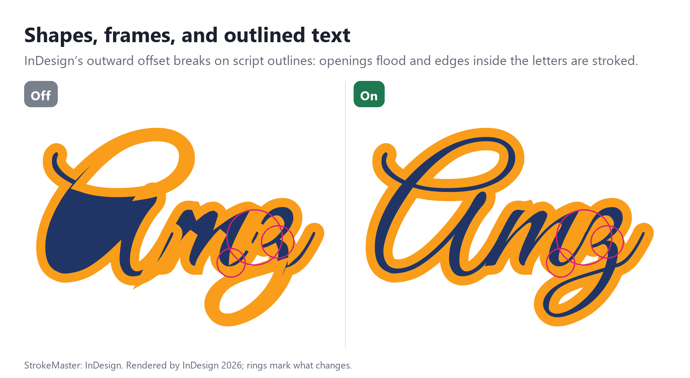

### Inside strokes

InDesign’s inward offset drops the thin parts of a letter or spills past them. *InDesign.*

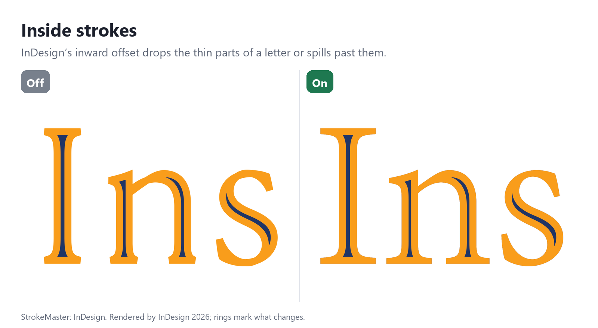

### Open paths

Past the miter limit, InDesign cuts an open path’s sharp points flat; closed shapes keep them whole. *InDesign.*

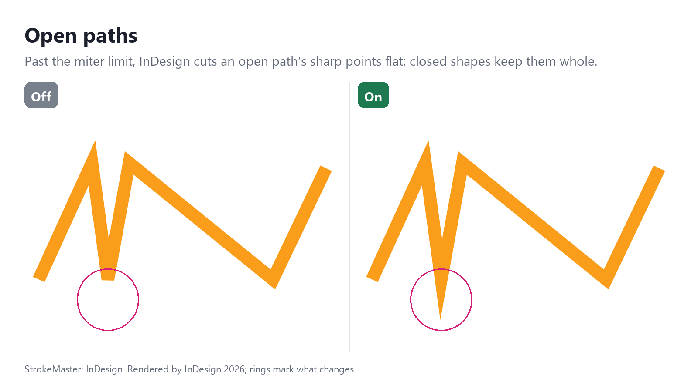

### Objects with opacity or effects

A translucent stroke is stroked once per contour, so it darkens where contours overlap. *InDesign.*

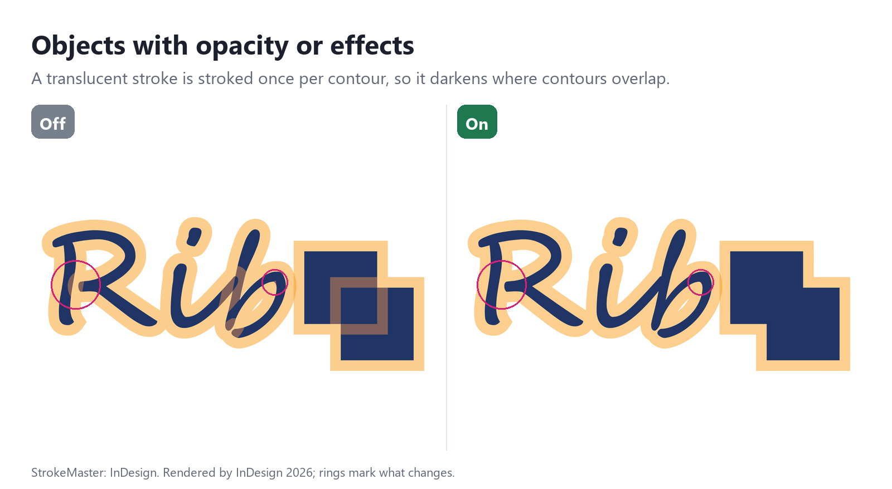

## Stacking

### Strokes behind other letters’ fills

Each line’s stroke covers the line above, and a recolored run’s stroke covers the letter before it. *InDesign and Illustrator.*

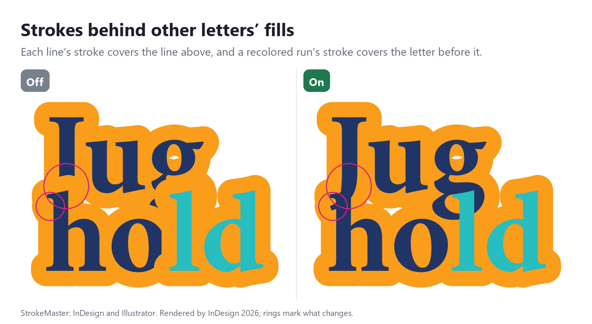

### Across a story’s threaded frames

The stroke of a threaded frame covers the letters of the frame before it. *InDesign and Illustrator.*

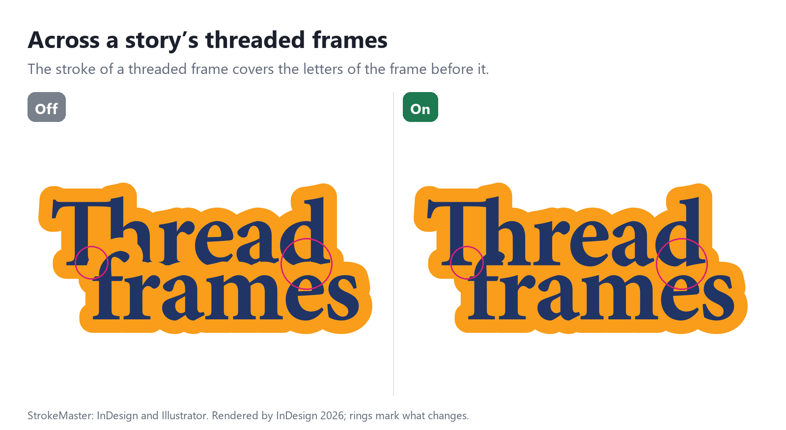

### Across separate stories

One story’s stroke covers the letters of another story it overlaps. Off by default. *InDesign and Illustrator.*

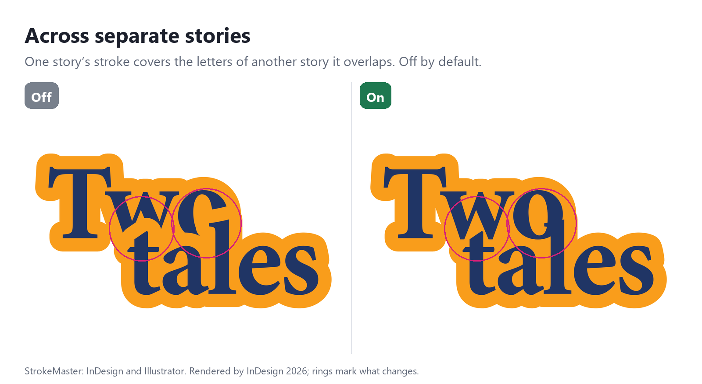

## Corners

### No miter spikes in live text

Miters at the inner corners of letters poke out through their thin parts as spikes. *InDesign and Illustrator.*

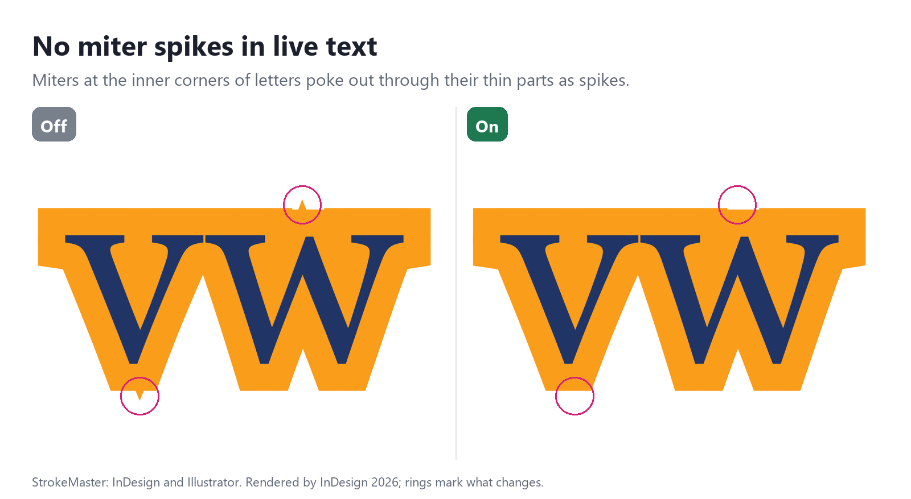

### No miter spikes in shapes and outlines

Miters at inner corners poke out through the thin parts of shapes and outlined text. *InDesign and Illustrator.*

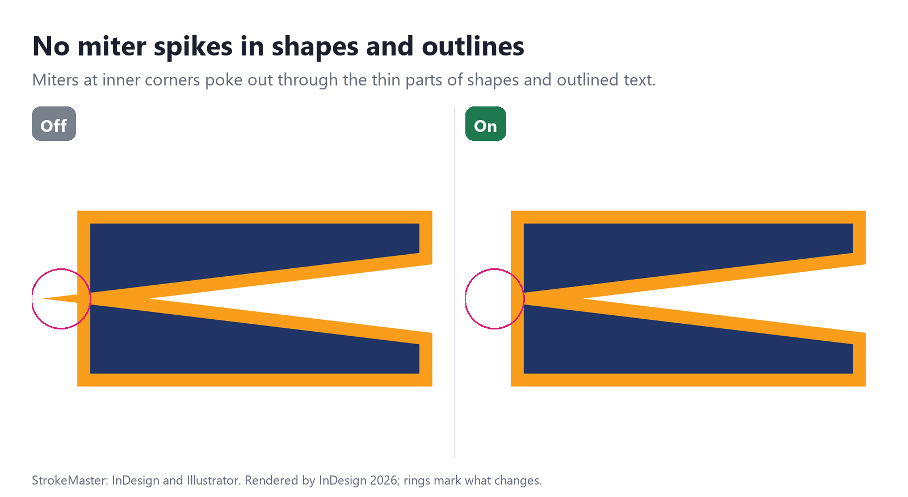

### Trim glyph tips

The sharp tips of letters end in long miter points. *InDesign and Illustrator.*

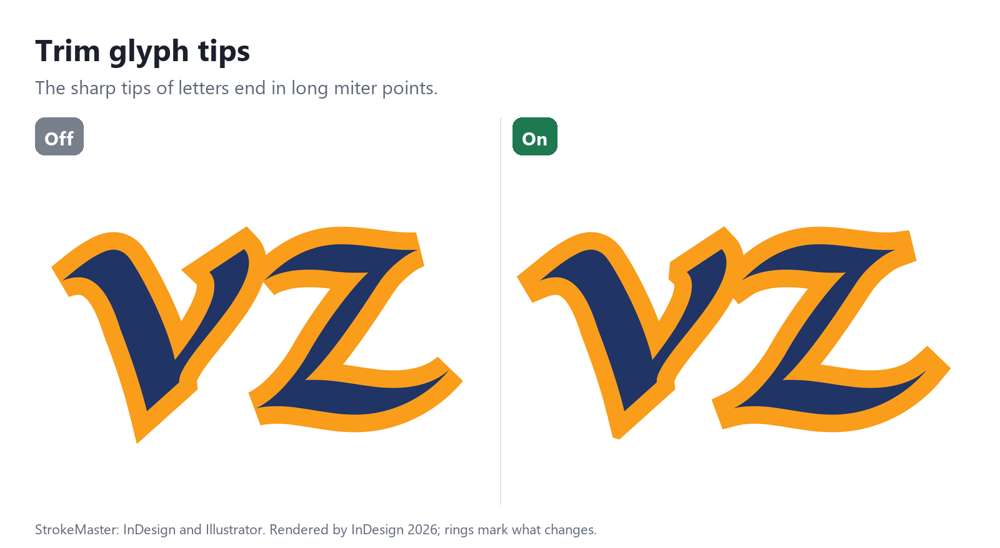

### Whole points past the miter limit

Past the miter limit, a shape’s own sharp points are cut flat at their tips. *InDesign and Illustrator.*

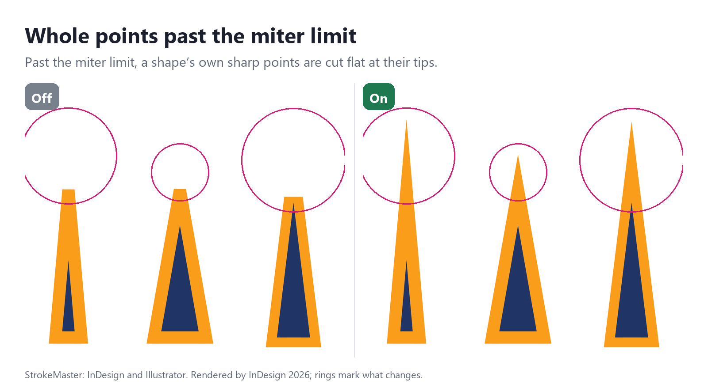

### Also on dashed and striped strokes

Dashed, dotted, and striped strokes lose their points to the pattern’s bevel. *InDesign and Illustrator.*

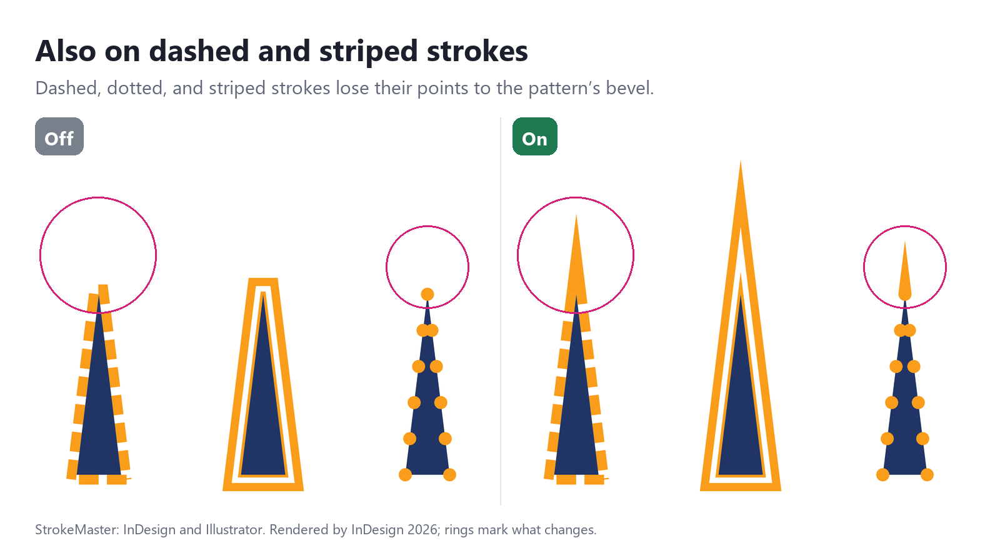

### Trim corner-effect corners

A corner effect’s small zigzags grow long miter points. Shown with Trim glyph tips off, which otherwise trims most of them. *InDesign.*

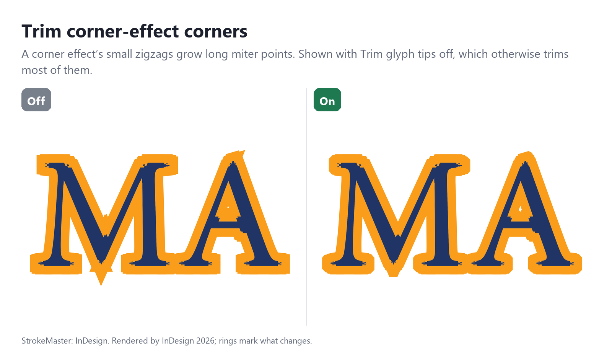

## Contours

### Overlapping contours get one outline

Overlapping contours are each stroked, so strokes run along edges inside the shape. *InDesign and Illustrator.*

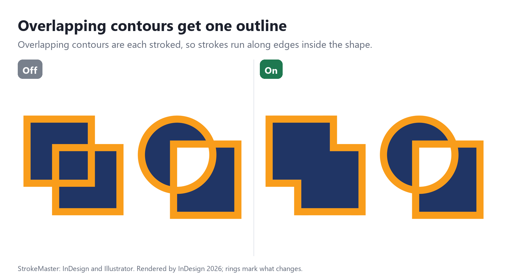

### One outline per word (dashes, stripes)

Dashes follow each contour, so they cross where letters and shapes overlap. *InDesign.*

### Close holes inside the outline

Counters, and the gaps that touching letters’ strokes close off, show what lies beneath. Off by default. *InDesign and Illustrator.*

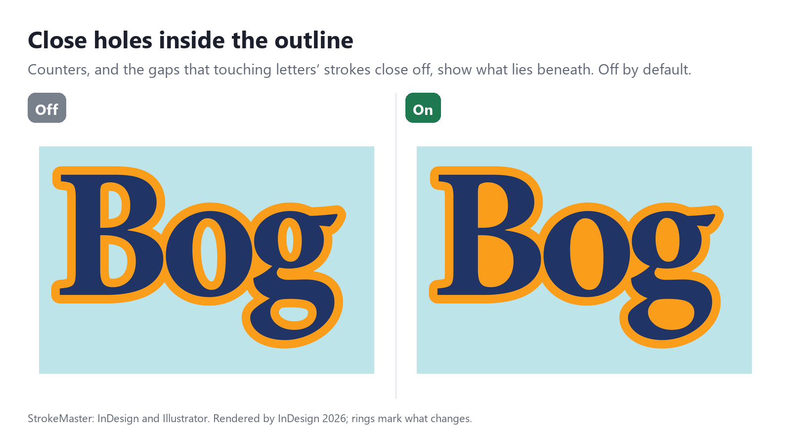
