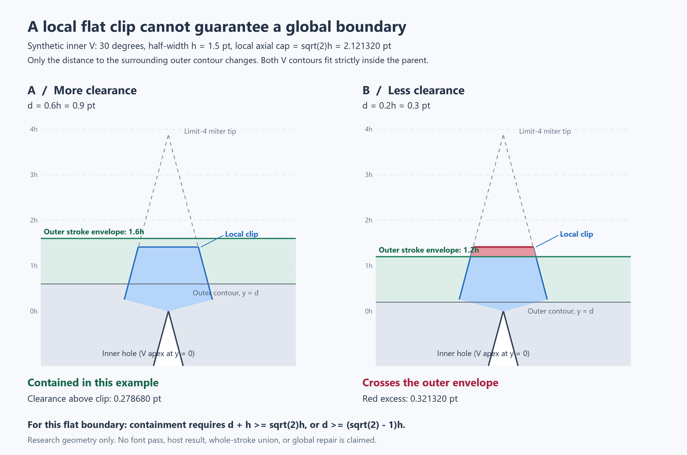

# Local miter geometry contract

This contract covers one outer join between two straight directions in a Cartesian plane. It does not certify a glyph outline, a whole stroke, a font, an Adobe integration, or a rendered result. The Python entry points are `stroke_outline.join_polygon` and `miter_geometry.corner_polygon`; both call `miter_rule.join_boundary`. ExtendScript has a separate `ISE_CLIP.joinPolygon` implementation. Agreement between the Python wrappers is integration evidence, not an independent geometry oracle.

## Units and derivation

Let the vertex be the origin, the outward bisector be the positive y-axis, the interior angle be θ, and α = θ/2. Set s = sin α, c = cos α, h = half the full stroke width, and L = cap/h. Both h and cap are lengths in the input coordinate system; L and the conventional miter limit are dimensionless. They are ratios to half-width, not full width.

A symmetric wedge has incoming direction (s, c), outgoing direction (s, −c), and outer offset endpoints p₁ = (−hc, hs) and p₂ = (hc, hs). Its offset lines are −cx + sy = h and cx + sy = h. Their intersection is the ordinary tip T = (0, h/s). Intersecting those lines independently with the clipping plane y = Lh gives:

- q₁ = (−h(1 − Ls)/c, Lh).
- q₂ = (+h(1 − Ls)/c, Lh).

Thus the clipped outer boundary is p₁, q₁, q₂, p₂. In a general orientation, rotate this local construction onto the outward bisector and translate it to the vertex. The filled-join wrapper prefixes the vertex. If the miter is retained, the boundary is p₁, T, p₂.

Interpolation toward T would require t = (cap − hs)/(h/s − hs), because each offset endpoint projects hs onto the bisector. The former t = (cap − h)/(tip − h) substituted the radial endpoint distance h for its axial projection hs. The implementation now intersects the plane directly; it never builds the distant tip on the clipped branch or on the conventional bevel branch.

For unit directions u and w, s = ‖u + w‖/2 and c = ‖u − w‖/2. The outward bisector follows u − w. Near a cusp, the difference is well conditioned; near straight travel, the implementation instead normalizes the sum of the outer normals. Turn orientation selects the outer normals and lateral ordering. This avoids recovering a tiny angle by subtracting `acos` from 180°. The JSX norm uses scaling before squaring because its target language does not require `Math.hypot`.

## Axial bound and branch policy

The plane condition is (p − vertex) · bisector ≤ Lh. It is not a radial disk. A flat corner has radius h√(L² + ((1 − Ls)/c)²), which can exceed Lh. For θ = 30°, h = 8, and L = √2, the correct corners are approximately (±5.250710387576569, 11.313708498984761), with radius 12.472768721266522. The default √2 preserves a right-angle tip but does not bound all corner radii by that tip's radius.

`CLIP_EPS = 1e-9` is a dimensionless relative branch tolerance. The miter is retained when s ≥ (1/L)/(1 + CLIP_EPS); otherwise the plane intersection is returned. Accordingly, a retained tip can exceed the nominal axial cap by this tolerance, plus floating-point rounding. The tolerance introduces a small branch discontinuity; no exact numerical continuity claim is made. `clipped_reach` and `is_clamped` use this same decision. The conventional `miter` branch retains a tip when s ≥ 1/limit and otherwise returns a bevel, without the clip tolerance.

## Supported local inputs and failures

Vertices contain two finite numeric coordinates. Half-width must be finite and strictly positive. Both ratios must be finite and at least 1, including when one ratio is inactive. This intentionally excludes planes below the stroke radius. Incoming and outgoing directions must have unit norm within 1e-12; accepted directions are renormalized. Modes are `clip`, `miter`, `bevel`, and `round`. Unknown modes, invalid numbers, invalid vector shapes, zero or nonunit directions, and nonfinite output or cap arithmetic fail explicitly with Python `ValueError` or JavaScript `Error`.

Exact straight continuation produces no join: `None` in the filled Python wrapper, `null` in JSX, and an empty boundary in the diagnostic wrapper. An exact reversal, or a numerically unresolved reversal with zero computed cross product, fails because its outward side is undefined. Representable nonzero near-cusp turns are handled without the old absolute cross-product cutoff. Scalar angle inputs use degrees in (0, 180]; the direction-angle helper can report 0 for a reversal, which the polygon kernel rejects. Positive angles that underflow to zero during conversion fail. Unclipped scalar reach requests that exceed finite range also fail.

The finite-precision envelope is local. Coordinates must retain the offsets of interest; translations vastly larger than h can erase detail before or during addition, and arbitrary near-degenerate rotated inputs can lose their turn sign. There is no arbitrary-scale, exact-predicate, or complete underflow guarantee. Synthetic tests cover h from 1e−200 to 1e200 and angles down to 1e−200 degrees in specified symmetric cases; those samples do not prove every combination of angle, translation, and scale.

Round joins remain polygonal approximations with 12 subdivisions in the filled Python and JSX entry points and 16 in the diagnostic boundary. The diagnostic previously chose the long arc for clockwise turns and assumed one outer side. It now uses the short outer arc and handles both turn orientations. These are intentional corrections; conventional joins in the filled entry points retain their geometry within the measured rounding differences below.

## Regression evidence — September 12, 2026

The first three tests were written and run before implementation changes. `test_plane_regression_outline`, `test_plane_regression_diagnostic`, and `test_plane_regression_jsx` all failed against the original implementations. At θ = 30°, h = 8, L = √2, the old first clip corner was approximately (−6.609694236199022, 6.241911729260270), placing its axial coordinate 5.071796769724491 below the specified plane. The original JSX differed only in the last few floating-point bits. The normalized x-coordinate assertion errors were 0.16987298107780668 for both Python implementations and 0.1698729810778069 for JSX, against a 3e−12 tolerance. Initial run: three tests, three failures.

The independent oracle in *tests/geometry/test_miter_geometry.py* solves the two symmetric offset-line equations at y = Lh; it imports no production angle or join helper for its expected coordinates. An additional 80-digit Decimal calculation uses radical expressions for sin 15° and cos 15° instead of binary trigonometry. Offset-line and clipping-plane residuals provide separate invariant checks. Neither the historical B3 measurements nor the two shared Python wrappers are presented as independent clipping validation.

Run the suite from the repository directory:

```powershell
python -B -m unittest discover -s tests/geometry -v
```

Executed with Python 3.14.6, Pillow 12.3.0, and Node v24.21.0 at *C:/Program Files/nodejs/node.exe*: **20 tests passed, zero failures, zero errors, zero skips**. The suite made 12,984 analytic coordinate comparisons; maximum |actual/h − expected/h| was 1.7763568394002505e−15 against a 3e−12 tolerance. This is an observed maximum on the test corpus, not a universal error bound. JSX was evaluated in Node's isolated VM with only the `$.global` shim; no Adobe objects or operations were used. The JSX source contains zero non-ASCII bytes. The harness locates Node on PATH or in the standard Windows installation directory, supports `ISE_NODE`, and explicitly reports JSX as unexecuted if no runtime exists.

Coverage includes all three original failure cases; conventional bevel/miter controls; the right-angle boundary and relative offsets around the clip epsilon; ratios 1, √2, 2, and 4; rotation, reflection, path reversal, translation, and similarity; five half-width scales; deterministic fuzz with seed 20260912 and 400 cases; near-straight and near-cusp turns, including a case whose unclipped tip would overflow; axial-versus-radial extent; round short arcs and subdivision counts; invalid modes, dimensions, directions, widths, ratios, NaN, infinities, and output overflow; and an explicit regression documenting that flattened chords differ from anchor-handle tangents. Three further tests verify fingerprint invariants and benchmark accounting on a synthetic triangle. One additional test verifies the contained and overflowing synthetic inner-V cases illustrated below.

A separate read-only comparison loaded the original Python and JSX sources from Git revision `fb15301`. Fifty conventional or retained-clip cases covered angles 10°, 30°, 60°, 90°, 120°, 150°, and 179°, both reflections, bevel, round, miter, and clip at angles at least 90°, with h = 8. Maximum old-versus-new Python coordinate difference divided by h was 4.4408920985006262e−16; old JSX versus repaired Python was 3.1086244689504383e−15. Repaired JSX is separately checked against the analytic expectations by the suite.

Independent review was obtained from the takeover supervisor: the supervisor independently read the implementation, derivation, and oracle, and reran the original 19-test suite successfully with no skips. The implementing session subsequently added the synthetic global-envelope test, bringing its final run to 20 passing tests. The earlier workspace review-worker resource refusal does not negate the later supervisor review. Node execution establishes host-independent JavaScript behavior, not execution in the ExtendScript runtime. A host caller must reevaluate *ise-clip-miter.jsx* to use the updated `ISE_CLIP`; no host was opened, reloaded, or otherwise operated, and no commit was created.

## Provisional KerberosFang extraction benchmark

The takeover host extraction measured KerberosFang “Lorem ipsum” at 12 pt in *build/takeover/extreme.json*. The takeover PDF census measured operators w = 3, j = 0, and M = 4 despite a character stroke-weight property of 1; these measurements came from the supervisor’s tools. This benchmark uses the resulting half-width **1.5**, rather than that character property. It did not reparse the PDF or operate a host. JSON source metadata is version 30.7.0, build 114R, “disposable copy.” The 2,612,642-byte input has SHA-256 `ee3e508b3f8b992ac5646b3de1b7e7f28d3488b99ae9cd90c771aed84e3290e3`.

The input contains 3,336 contours and 20,308 anchors. There are **3,336 distinct exact ordered geometry fingerprints and 3,336 distinct fingerprints after canonicalizing cyclic starts and traversal reversal**, with incoming/outgoing handles swapped on reversal. Metadata, area, bounds, and style are excluded; coordinates are not rounded or translation-normalized. Thus this test found no duplicate geometry records consistent with repeated descendant walking. It does not prove object identity or exclude near-duplicate records. All contours report closed = true and strokeWidth = 0. Recorded area signs are 2,082 positive, 1,207 negative, and 47 zero; signs alone do not classify holes.

The benchmark preserves the experimental anchor corner classification and 24-step flattening, producing 337,294 flattened vertices. It excludes 326,334 smooth vertices and considers 10,960 flagged corner candidates. **10,781 local joins evaluate successfully; 179 fail explicitly with “cusp or unresolved turn: outward side is undefined,” across 92 contours.** Failures remain in the report rather than being silently turned into bevels or omitted from the denominator. The benchmark does not call the whole-path stroker; that stroker would propagate an encountered invalid join.

| Local result at h = 1.5 and L = √2 | Count or measured value |
| --- | ---: |
| Retained clip miter; unchanged from limit-4 model | 5,756 joins |
| Flat clip; shorter axially than a retained native-model miter | 4,121 joins |
| Flat clip; longer axially than a native-model bevel | 904 joins |
| Total flat clips | 5,025 joins |
| Conventional model: retained miter / bevel | 9,877 / 904 joins |
| Nominal local axial cap | 2.121320343559643 pt |
| Maximum returned clip axial extent, including epsilon | 2.1213203435897885 pt |
| Maximum returned clip radial extent | 2.5980762113508966 pt |
| Maximum conventional-model axial and radial extent | 5.994807484528787 pt |
| Maximum flat-plane residual | 5.639932965095795e−14 pt |
| Maximum offset-line residual | 5.728750807065808e−14 pt |

All 5,025 flat clips exceed the nominal axial cap radially. The conventional-model comparison is a calculation on these extracted local chord directions using limit 4, not a measurement of the native PDF's painted outline. The extracted contours may already include expanded Appearance geometry, and the JSON does not record enough provenance to resolve that. Applying h = 1.5 to every extracted contour is therefore a **provisional hypothetical local-stroke benchmark**, not evidence that the intended live text stroke or glyph silhouette has been reconstructed.

The takeover renderer comparison measured material spike-silhouette differences between MuPDF 1.28.2 and system Poppler at the same 864 dpi and clip [90, 190, 178, 230], using *build/takeover/extreme-preview.png* and *build/takeover/extreme-poppler.png*. The supervisor’s tool comparison identified more than antialiasing variation. This implementing session did not rerender or independently attribute that discrepancy. Curves, font outlines, and tiny-angle stroking remain possible explanations, not findings. The direct PDF is therefore not the sole oracle for an ideal native stroke silhouette; the local join repair is validated against analytic vector geometry independently of either renderer.

The reproducible tool is *tests/geometry/benchmark_extracted_paths.py*. Full counts, failure examples, quantiles, fingerprint results, and provenance are in *tests/geometry/extreme_join_statistics.json*. The executed command was:

```powershell
python -B tests/geometry/benchmark_extracted_paths.py build/takeover/extreme.json --half-width 1.5 --output tests/geometry/extreme_join_statistics.json
```

## Whole-stroke limitations remain

`stroke_shapes` and `strokeShapes` remain experimental. They always close contours; they do not implement open-contour caps, hole containment and fill-rule processing, self-intersection resolution, or a vector Boolean union. Curves use fixed subdivisions. Handle-collapse decisions use an absolute 1e−6 coordinate-unit threshold, the legacy flattening direction helper has an absolute 1e−12 cutoff, and corner tagging uses 0.75°. Actual joins use neighboring flattened chords, not exact Bezier endpoint tangents. The tests record this distinction without claiming an adaptive offset-error bound. The existing raster validator evaluates conventional miters against saved expansion data; it does not establish clipping correctness. None of these whole-stroke limitations is repaired or certified by this bounded join change.

## Synthetic global-envelope counterexample



The figure is a research drawing of a 30° triangular inner contour strictly contained in a surrounding rectangular outer contour. It renders the local join returned by the repaired kernel, the analytic conventional limit-4 miter, and the surrounding contour’s top stroke boundary. It is not a rasterized font or an Adobe host result. The rectangle extends from x = −5h to 5h and y = −8h to d; the inner triangle has apex (0, 0) and lower vertices (±5h tan 15°, −5h). Only the top neighborhood is shown.

For a centered stroke with h = 1.5 pt, the surrounding top contour at y = d has outer stroke boundary y = d + h. The default local clip lies at y = √2h = 2.121320343559643 pt. With d = 0.9 pt, the outer boundary is y = 2.4 pt, leaving 0.2786796564403571 pt above the local clip. With d = 0.3 pt, the outer boundary is y = 1.8 pt, so the local clip exceeds it by **0.3213203435596428 pt**. The red region marks that excess.

For this flat-boundary example, local containment requires d ≥ (√2 − 1)h; the local join function receives no surrounding-contour distance and cannot enforce that condition. The same local V and half-width therefore give both a contained case and a counterexample. This establishes that the repaired local axial policy alone does not guarantee the intended global inner-spike boundary. It does not select or implement a global contour-clipping algorithm.

The figure was generated and visually inspected as *tests/geometry/local_vs_global_envelope.png*. Its numeric construction is saved in *tests/geometry/local_vs_global_envelope.json*. The executed reproduction command is:

```powershell
python -B tests/geometry/render_local_envelope.py
```

No corrected full-font rendering was produced by silently excluding the 179 rejected cusp/unresolved-turn joins. They remain explicit failures of the current join-only envelope. Resolving them requires stroke semantics rather than an arbitrary bevel fallback: the next isolated host controls should compare an exact U-turn under miter, bevel, and round joins, then a wholly closed two-anchor contour under the same modes, with cap and closure behavior recorded separately. Those controls remain pending; no Adobe host operation or cusp special case was added in this bounded follow-up.

## Original objective and next bounded architecture experiment

The original *W.jpg* inner-spike objective remains the acceptance criterion: inner joins must respect the intended surrounding outer stroke envelope. The repaired local flat clip is an optional join policy. Even when its local plane intersections are correct, it cannot by itself satisfy that original global guarantee, as the synthetic counterexample demonstrates. The objective is already established; no new user choice between a local policy and the original boundary requirement is needed.

The next geometry stage must account for the whole filled region and its topology, including contour containment, holes, fill rules, and overlaps. A bounded experiment should compare a one-sided outward offset of that filled region, with join construction at convex exterior corners, against symmetric stroking that also constructs inward miter tips. “Outward” and convexity must be defined relative to the filled region, including counter boundaries, rather than inferred from a contour’s traversal direction alone. Offset distance must be calibrated to the measured stroke contribution. This is an architectural inference for an experiment, not implementation proof: it does not establish that a particular offset or Boolean operation already delivers the desired envelope, handles cusps, or preserves all Appearance semantics. The existing local kernel remains a tested component, not the global solution.

The takeover PDF census identifies the embedded font as TrueType `/KerberosFang`, not CFF. An independent provenance check should compare the extracted contours with glyph outlines from that actual embedded font subset, accounting for PDF character-to-glyph mapping, units per em, text transforms and placement, composite glyphs, contour ordering, and quadratic-to-cubic curve representation before treating coordinate differences as Appearance expansion. This could distinguish base glyph geometry from expanded or otherwise transformed Appearance geometry; the result is not yet known.

Initial availability checks found `fontTools` in neither Python environment. The supervisor subsequently installed fontTools 4.65.0 in the repository virtual environment; this implementing session installed nothing. The bounded count comparison below has now run, while coordinate-level extraction provenance remains unresolved. The renderer disagreement and the 179 explicit cusp/unresolved-turn failures also remain limitations; this contract update does not weaken either gate or imply a full-font pass.

## Embedded TrueType provenance count baseline

The read-only research tool *tests/geometry/font_provenance.py* uses fontTools `TTFont` and `DecomposingRecordingPen`, plus pikepdf, to count contours from the PDF’s actual embedded font program. It runs without an Adobe host. Font bytes stay in memory; the report contains hashes, metadata, glyph names, and operation counts, not font programs or outline coordinates. Optional local source-font comparisons omit filenames and paths from the report. This bounded parser accepts direct-page simple TrueType text with explicit WinAnsiEncoding and printable ASCII; unsupported forms, font overrides, encodings, and open glyph paths fail explicitly.

The independently executed census identifies `/DQDNKI+KerberosFang`, `/TrueType`, `/WinAnsiEncoding`, units per em 1000, and a 72,686-byte embedded font stream with SHA-256 `58dd2f9e81598200d53e86781b794ae2b0dfd3eaa0bed2ac010f436685401586`. The PDF SHA-256 is `c24f3e94a66ee571160950619de888c0d8f3ea7f723ce5edb850193e542173fa`. Three `Tj` occurrences paint “Lorem ipsum”: one in stroke mode with raw graphics state w = 3, j = 0, M = 4, and two in fill mode. The three occurrences are reported separately; summing their 10,656 contour paint occurrences would not establish 10,656 unique geometry contours or be a valid comparison with a single extracted text run.

| Position | Character | Embedded subset contours | System version 1.000 contours |
| --- | --- | ---: | ---: |
| 1 | L | 289 | 289 |
| 2 | o | 508 | 508 |
| 3 | r | 648 | 648 |
| 4 | e | 120 | 120 |
| 5 | m | 266 | 266 |
| 6 | space | 0 | 0 |
| 7 | i | 38 | 38 |
| 8 | p | 321 | 321 |
| 9 | s | 377 | 377 |
| 10 | u | 719 | 719 |
| 11 | m | 266 | 266 |
| Total | Lorem ipsum | 3,552 | 3,552 |

The two named system-font installations were independently read and have identical SHA-256 `b94a0ee247b8be9cc41d9c811d9ca01710c91974c13a9255dc9f1b72aa052687`, version 1.000, units per em 1000, and the exact per-character contour counts above. The report deduplicates their identical font bytes and records two matching input files. The supervisor separately measured a different user-installed Hanoded-KerberosFang version 1.004, SHA-256 `7815082d1b31aa21a7a38aa1aa4d6182396962599e8c283e62575e5e7f8bbf4d`, with 820 contours for this text. This session did not read that user-installed font; its private path is neither needed nor stored here.

The extracted single-run count remains 3,336, with 20,308 anchors and 3,336 distinct ordered coordinate fingerprints. Thus the embedded subset has **216 more decomposed contours per text run**. This is positive evidence against exact contour-count identity between these two representations; it does not establish that their filled regions differ, identify the actual source font used by the extractor, or show that Appearance was expanded. The embedded subset’s count baseline matches version 1.000, not the supervisor’s measured version 1.004 baseline, but counts and names alone do not prove font identity. Bounds, source labels, or units per em cannot settle that question. Quantization, degenerate-contour handling at export size, contour cleanup, curve conversion, source selection, and Appearance remain hypotheses requiring discrimination. No per-character mapping from the 3,336 extracted contours has been established.

The complete numeric baseline is *tests/geometry/extreme_font_provenance.json*. The census was run against the PDF and extraction with the two system-font files as optional read-only inputs. The PDF-only reproduction command is:

```powershell
.venv\Scripts\python.exe -B tests/geometry/font_provenance.py --pdf build/takeover/extreme.pdf --extraction build/takeover/extreme.json
```

Six in-memory tests check composite-glyph decomposition and repeated characters; explicit rejection of open paths, unsupported mappings, and missing components; text-show arrays with spacing adjustments; and contour point-count classification. The repository virtual environment ran the complete **26-test suite with zero failures, errors, or skips** using fontTools 4.65.0 and pikepdf 10.13.0.post1. Environments lacking these optional research dependencies explicitly skip those six tests; the original geometry tests remain separate. No source font was copied into the repository or distributed.

### Two-point contour measurement and unresolved deficit

The provenance tool now also uses `DecomposingRecordingPointPen` to count explicit TrueType points per contour, including both on-curve points and off-curve controls. These counts exclude implied quadratic points and are not counts of curve segments. The point-pen contour total is checked against the segment-pen total for every character; missing components fail explicitly rather than disappearing. A separate read-only check using raw `glyf.getCoordinates` endpoint arrays reproduced the entire embedded-font point-count histogram.

| Position | Character | Embedded single-point contours | Embedded two-point contours |
| --- | --- | ---: | ---: |
| 1 | L | 0 | 0 |
| 2 | o | 0 | 46 |
| 3 | r | 0 | 40 |
| 4 | e | 0 | 3 |
| 5 | m | 0 | 3 |
| 6 | space | 0 | 0 |
| 7 | i | 0 | 0 |
| 8 | p | 0 | 27 |
| 9 | s | 0 | 13 |
| 10 | u | 0 | 80 |
| 11 | m | 0 | 3 |
| Total | Lorem ipsum | 0 | 215 |

Of the 215 two-point contours, 197 have both points on-curve and 18 include an off-curve point. Independently classified by coordinate equality, 197 have distinct coordinates and 18 have coincident coordinates. The complete histogram and both classifications are in *tests/geometry/extreme_font_provenance.json*. The independently read system version 1.000 font has the same full explicit-point histogram for this text.

Hypothetically subtracting all 215 two-point contours from 3,552 leaves **3,337**, which is still **one more** than the extracted 3,336. The numeric proximity is an experimental lead, not a demonstrated explanation of the 216-contour deficit. The extraction itself contains **128 two-anchor contours**. TrueType points include off-curve controls, whereas Illustrator anchors belong to a different curve representation, so these counts cannot be paired by cardinality alone. A zero-fill-area two-point contour can also contribute stroked geometry; its removal is not automatically semantics-preserving. No removal, glyph-to-extraction contour mapping, size-dependent collapse, or Appearance expansion has been established, and the tool does not discard these contours.

The PDF-only command above reproduces the embedded histogram and hypothetical deficit calculation. Optional `--source-font` arguments also reproduce the local system-font comparison without recording source paths or exporting font data. The new tests distinguish singleton, coincident two-point, distinct two-point, and off-curve point cases and ensure missing components raise errors. The final result remains a bounded provenance research artifact, not a full-font or global geometry pass.
